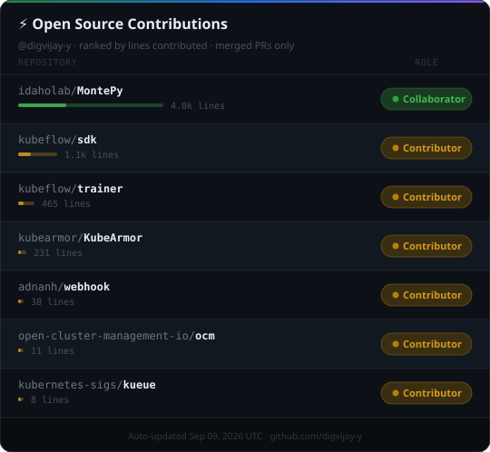

  

  

  📍 India

  
  
  

---

### 🚀 About me

- 🛠️ **DevOps (Platform) Engineer** at **Cogrion**, building multi-cloud, multi-tenant architecture
- 🧠 Building **AI inference infrastructure** — models served over **gRPC** and **REST APIs**
- 🏆 **Top 4%** in the **WorldQuant International Quant Championship 2025**
- 🧮 Love for mathematics, numerical methods, and high-performance computing
- 💬 Ask me about gRPC, REST APIs, Kubernetes, Terraform, AI infra, or quant research

---

### 🎯 Focus areas

  
  
  
  

---

### 🔌 APIs & interfaces

  
  
  
  
  

### 🧠 AI inference & infrastructure

  
  
  
  
  

---

### 🛠 Tech stack

  

---

### 📈 GitHub activity

  

  
  

  

---

### 🐍 Contribution snake

  <picture>
    <source media="(prefers-color-scheme: dark)" srcset="https://raw.githubusercontent.com/digvijay-y/digvijay-y/output/snake-dark.svg"/>
    
  </picture>

---

  
  

---

### 🔝 Top contributed repos

  

---

  <i>"Engineer with curiosity, discipline, and caffeine — with a love for mathematics and computer science."</i>

  

